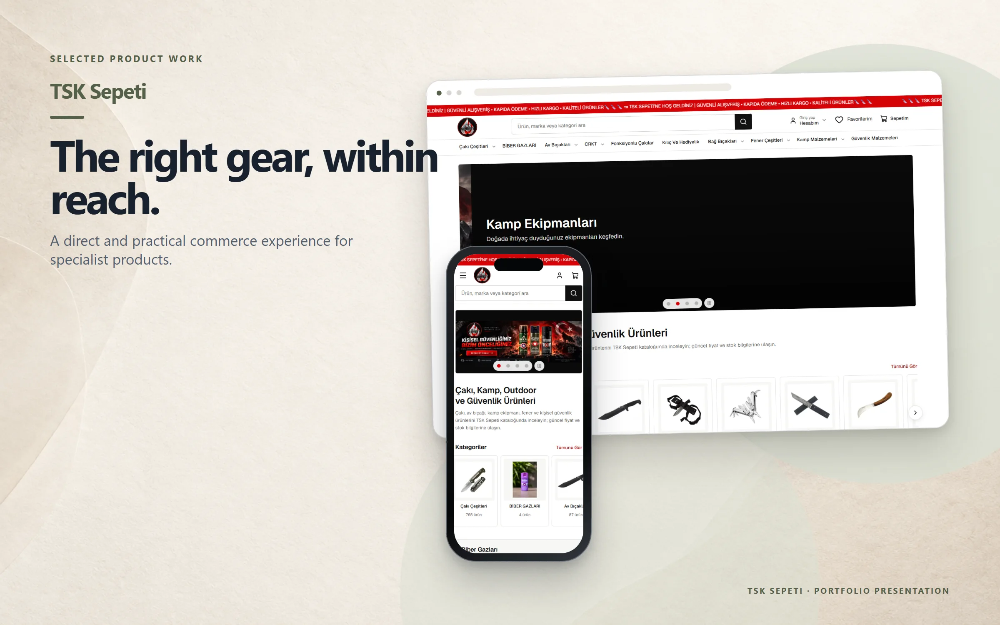
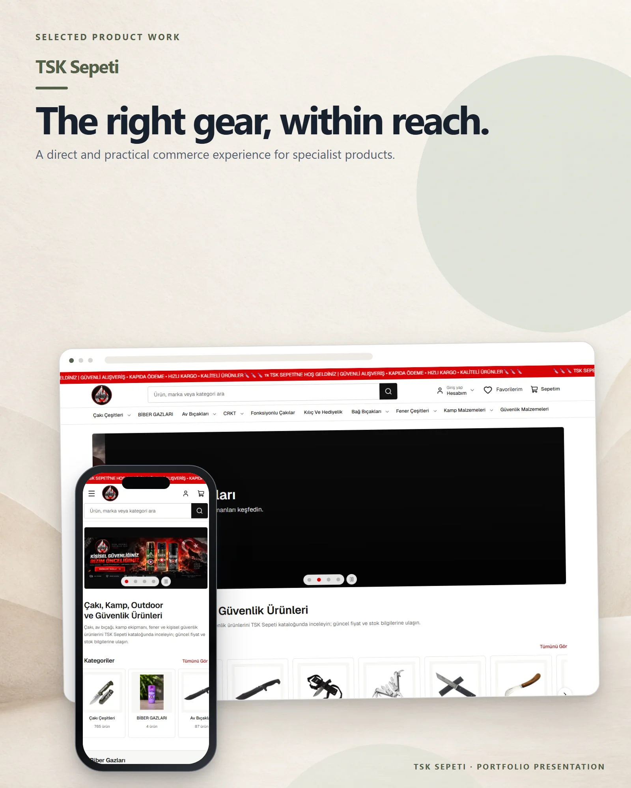

# TSK Sepeti

An online store for knives, outdoor equipment, lighting, camping and personal security products.

**Live:** [tsksepeti.com](https://tsksepeti.com) &nbsp;·&nbsp; **More work:** [github.com/mertomeroglu](https://github.com/mertomeroglu)

### Highlights

- Category-led catalogue and product search
- Best-seller and new-arrival sections
- Account, favourites and cart entry points
- Responsive product browsing on desktop and mobile

### Built with

Next.js · React

---

Presentation-only repository: this README and two presentation images built from real product screens. Application source and private configuration are not published here. Visual content and brand assets remain the property of their respective owners — see [LICENSE](LICENSE).
