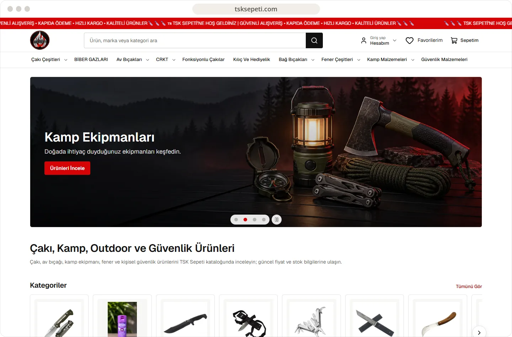
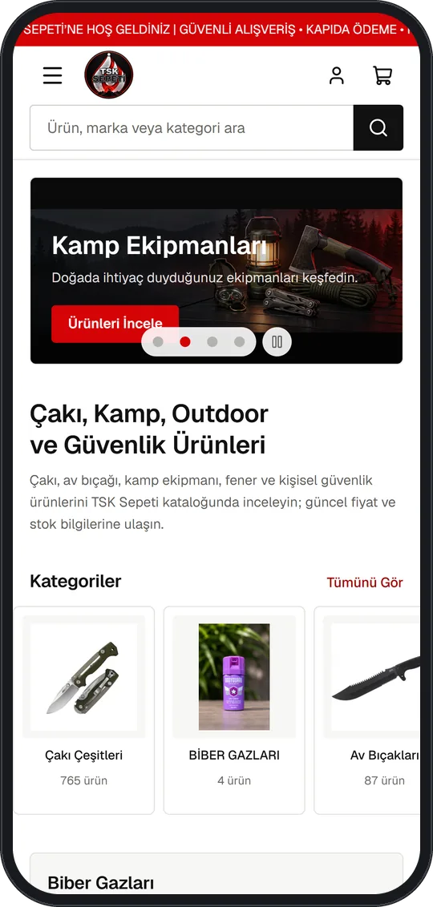

# TSK Sepeti

An e-commerce catalogue for knives, outdoor equipment, lighting, camping, and personal security products.

**[Visit live website](https://tsksepeti.com)**

## Highlights

- Category-led catalogue and product search
- Best-seller and new-arrival discovery sections
- Account, favourites, and cart entry points
- Responsive product browsing across desktop and mobile

## Verified technology

Next.js and React are confirmed from the live public application output. No unverified backend technology is claimed here.

## Live interface

 

## About this repository

This presentation-only repository contains selected public screenshots, this README, and a small static introduction page. Application source and private configuration are not published here.

Visual content and brand assets remain the property of their respective owners. See [LICENSE](LICENSE).
