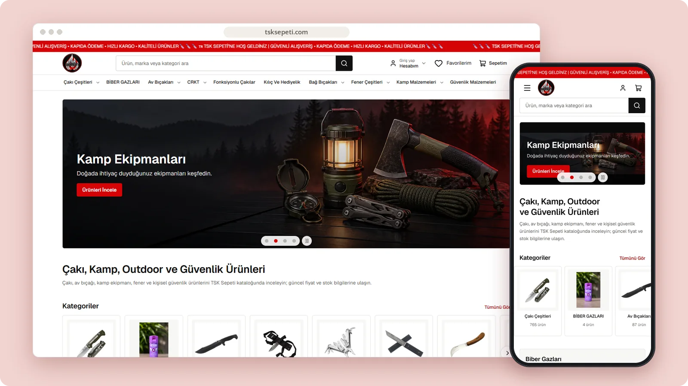

# TSK Sepeti

An online store for knives, outdoor equipment, lighting, camping and personal security products.

**[Visit tsksepeti.com ↗︎](https://tsksepeti.com)** &nbsp;·&nbsp; [More work by Mert Ömeroğlu](https://github.com/mertomeroglu)

### Highlights

- Category-led catalogue and product search
- Best-seller and new-arrival sections
- Account, favourites and cart entry points
- Responsive product browsing on desktop and mobile

### Built with

Next.js · React

### Screens

---

Presentation-only repository. Images are real, unmodified product screens in a simple frame; application source and private configuration are not published here. Brands and visual content belong to their respective owners — see [LICENSE](LICENSE).
